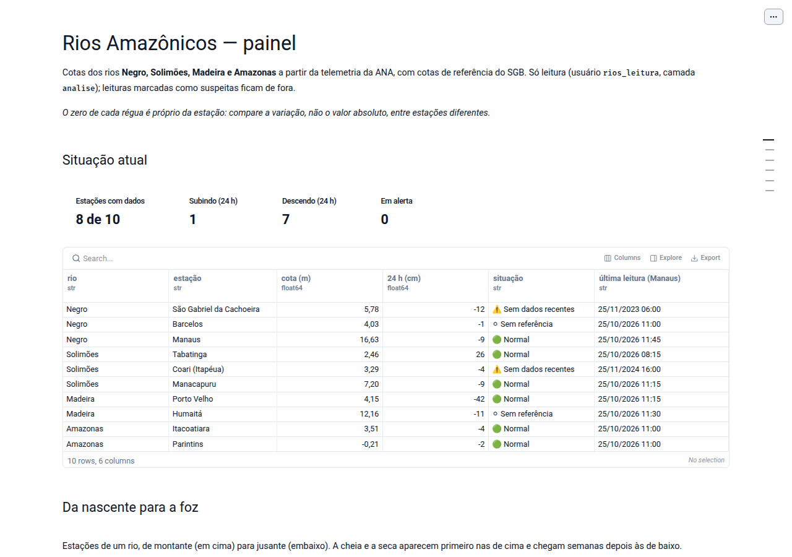
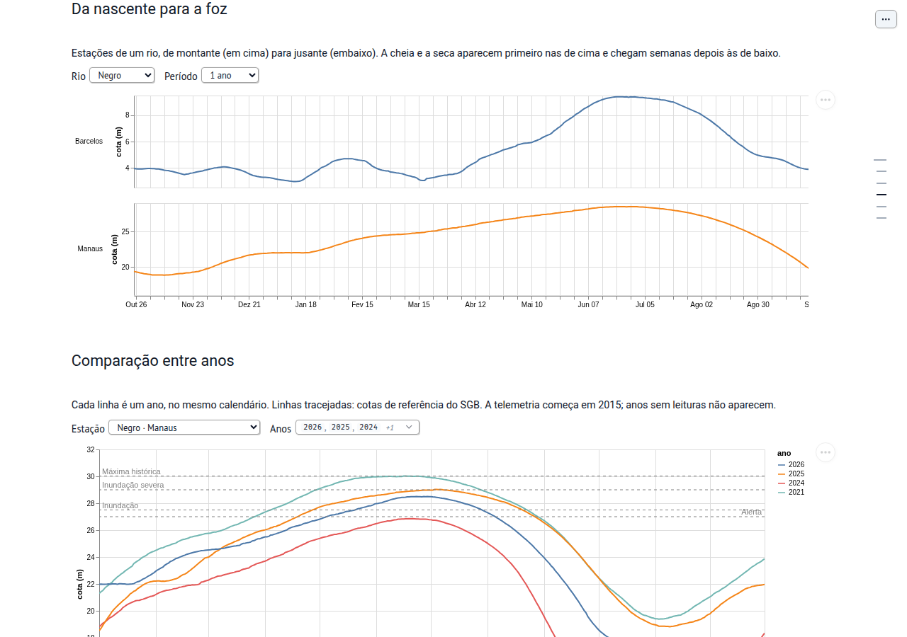
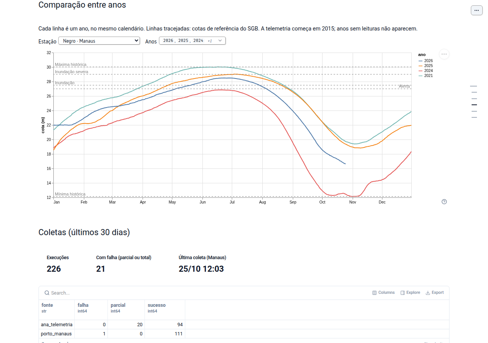

# Rios Amazônicos

[](https://github.com/DevJanderson/rios-amazonicos/actions/workflows/ci.yml)
[](LICENSE)

Monitor aberto das cotas dos rios **Negro, Solimões, Madeira e Amazonas**.
Reúne dados oficiais (ANA, SGB, Porto de Manaus), limpa e guarda o histórico, e
entrega um painel e um bot no Telegram para a comunidade amazonense.



## O que o projeto faz

- **Coleta de hora em hora** da telemetria da ANA e da tabela do Porto de Manaus,
  sem duplicar dados quando roda de novo.
- **Limpeza com rastro**: decimal com vírgula, dia repetido, erro de digitação e
  saltos bruscos viram leituras `corrigida` ou `suspeita`; o valor original
  nunca é apagado.
- **Histórico desde 2015**: cerca de 1,9 milhão de leituras das 10 estações.
- **Painel** (marimo): situação atual, a cheia e a seca descendo cada rio,
  comparação entre anos com as cotas de referência do SGB, coletas e qualidade.
- **Bot no Telegram** (n8n): `/nivel <cidade>`, `/semana <cidade>`, boletim
  diário às 7h30 e alertas quando uma estação muda de situação.

| Da nascente para a foz | Comparação entre anos |
|---|---|
|  |  |

## Estações

| Rio | Estações (montante → jusante) |
|---|---|
| Negro | São Gabriel da Cachoeira, Barcelos, Manaus |
| Solimões | Tabatinga, Coari, Manacapuru |
| Madeira | Porto Velho (RO), Humaitá |
| Amazonas | Itacoatiara, Parintins |

Estações novas entram por cadastro no banco, sem mudar código. Códigos da ANA,
cotas de referência e problemas conhecidos de cada estação: [docs/dados.md](docs/dados.md).

## Arquitetura

```
ANA telemetria ─┐
Porto de Manaus ┼─► coletor (Python) ─► PostgreSQL "rios" ─┬─► painel marimo (só leitura)
HidroWeb (carga)┘   de hora em hora      bruto → dados →    └─► n8n ◄─► bot Telegram
                                         analise
```

- `bruto`: resposta original de cada coleta; `dados`: fonte da verdade;
  `analise`: views lidas pelo painel e pelo bot.
- Um usuário de banco por serviço, com permissão mínima.
- O coletor é independente do n8n: se a coleta falhar, o bot continua respondendo.
- A regra do bot fica no banco (schema `bot`); o n8n só repassa mensagens.

## Como rodar

Requisitos: [uv](https://docs.astral.sh/uv/), Docker com PostgreSQL 17 e, para
o bot, um n8n e um bot do Telegram.

```bash
git clone https://github.com/DevJanderson/rios-amazonicos.git
cd rios-amazonicos
cp .env.example .env          # preencha senhas e conexão (nunca vai para o git)

bash db/aplicar.sh            # cria banco, usuários, esquema e estações
cd coletor
uv sync
uv run python notebooks/coleta.py               # uma coleta
uv run marimo run notebooks/painel.py           # painel em http://localhost:2718
```

- `db/aplicar.sh` usa o container `pg-projects`; mude com `PG_CONTAINER=nome`,
  ou use `PG_CONTAINER=""` com `PGHOST`/`PGUSER` para um `psql` local.
- Coleta automática e painel como serviços systemd: `deploy/instalar.sh`.
- Bot: `n8n/importar.sh` importa o workflow e as credenciais no n8n; depois,
  publique o workflow no editor.

## Desenvolvimento

```bash
cd coletor
uv run ruff check . && uv run ruff format --check .
uv run ty check
uv run pytest
```

Os testes de banco rodam quando há conexão configurada (`.env` ou variáveis
`RIOS_*`); sem ela, são pulados. O CI do GitHub sobe um PostgreSQL vazio, aplica
o esquema e uma carga mínima de exemplo.

Quer ajudar? Veja o [guia de contribuição](CONTRIBUTING.md).

## Documentação

- [docs/PRD.md](docs/PRD.md): visão do produto, personas e requisitos
- [docs/dados.md](docs/dados.md): dicionário de dados, regras de limpeza e cotas de referência
- [docs/fases.md](docs/fases.md): histórico do desenvolvimento

## Fontes e uso responsável

Dados da [ANA](https://www.gov.br/ana/) (telemetria e HidroWeb), do
[SGB](https://www.sgb.gov.br/) (cotas de referência) e do
[Porto de Manaus](https://portodemanaus.com.br/nivel-do-rio-negro/). O coletor
faz no máximo uma requisição por hora por fonte e se identifica no User-Agent.

Este projeto **informa, não substitui** os alertas oficiais da Defesa Civil e
do SGB.

## Licença

[MIT](LICENSE).
